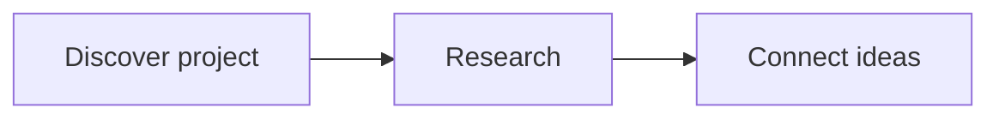

# Jev research index

A small shared inventory of Jev projects, evidence-backed connections, and ideas to explore.

Start with [INDEX.md](INDEX.md). Detailed research stays in the linked research tasks; this repository keeps the shared index available across computers.

## Use on another computer

Clone this private repository using an authenticated GitHub account with access:

```sh
git clone https://github.com/feraranas/system-one-jev.git
cd system-one-jev
```

Before editing, with a clean working tree:

```sh
git pull --ff-only
```

After updating the index:

```sh
git add INDEX.md
git commit -m "Update Jev research index"
git push
```

If a push is rejected because another computer pushed changes, fetch and reconcile those changes before retrying. Preserve both contributions; do not force-push to bypass a conflict.

Suggested research prompt:

> Read INDEX.md, investigate this project, and update the index.

Git synchronizes committed files. It does not copy research task histories or grant access to linked tasks.

## Research notebook UI

From the repository directory, run with Python 3.9 or later:

```sh
python3 ui/serve.py
```

Open [the local notebook](http://127.0.0.1:8765). It includes project search, mechanism filters, full research notes, connections, and ideas. Click **Refresh notes** after pulling or editing files. Research still comes from `INDEX.md` and its linked `research/*.md` files. Each expanded project also has a personal notepad stored separately in SQLite.

The server binds only to your computer's loopback address and exposes only the UI and inventory data. Stop it with Ctrl+C. Use `python3 ui/serve.py --port 8766` if the default port is occupied. On another computer, pull the repository and run the same command. Nothing is publicly hosted.

The Markdown reader supports headings, paragraphs, lists, tables, fenced code, links, inline code, and bold text. Keep project rows in the existing index table format and separate mechanisms with semicolons. Add a `Status:` line to research notes to display their evidence status; notes without one show “Status not recorded.”

## My notes

Expand a project and use **My notes**, then **Save notes**. There is one notepad per project ID. Notes appear beside the research on wide screens and below it on small screens. The save indicator confirms when a write succeeds.

The database is `.local/notes.sqlite3`, created automatically and excluded from Git. Saved notes survive restarts; Git clone/pull does **not** transfer them. Unsaved drafts remain in memory while switching projects, filters, or views. Closing/reloading the page prompts if a draft is unsaved; save before leaving. **Load saved version** fetches the current database copy and asks before discarding a changed draft.

If another tab saved first, the server rejects the stale save and keeps your draft in the editor. Copy it somewhere safe, load the saved version, and reconcile the two before saving again. Notes are plain text, never executed as HTML.

To back up or move notes, stop the server and copy `.local/notes.sqlite3` to a safe location. Restore it with the server stopped. An alternative location can be supplied with `--notes-db /absolute/path/notes.sqlite3`. Do not overwrite an existing database when migrating without first backing it up.

This is a local, single-user feature. The server checks local Host/Origin values and remains bound to loopback. Hosting at a future domain requires authentication, HTTPS, a production server, persistent storage, and backups; DNS alone does not make this local server ready for public use. The existing Markdown inventory and SQLite notes can both move to that server.

Validation: `python3 -m unittest discover -s ui -p 'test_*.py'` tests persistence, project isolation, revision conflicts, and HTTP write boundaries using temporary databases.

## Photos and Mermaid diagrams

Research Markdown supports images using standard inline image syntax:

```markdown

```

For `research/P001-jevgrep.md`, this resolves to `research/assets/P001-demo.png`. Create that folder and copy your image there. Paths with spaces can use angle brackets: ``. Local PNG, JPEG, GIF, WebP, and AVIF files anywhere inside `research/` are supported. Direct HTTP(S) image URLs work too; they load from the external host. Images resize to fit the research column. Local SVG and arbitrary filesystem paths are not served.

Diagrams use fenced Mermaid blocks:

````markdown

````

Click **Refresh notes** after editing Markdown. Diagrams also work inside expanded Connections and Ideas entries in `INDEX.md`; image paths there are relative to the repository root (for example `research/assets/P001-demo.png`). Each diagram has an expandable source view. Invalid diagrams retain their source with an error message.

Mermaid 11.12.0 loads on demand from jsDelivr and requires internet access on first load. Diagram rendering happens in the browser. If the library cannot load, the source remains readable. **My notes** is still a plain-text notepad, not a Markdown preview.

Additional renderer checks: `node ui/test_media.cjs`.
